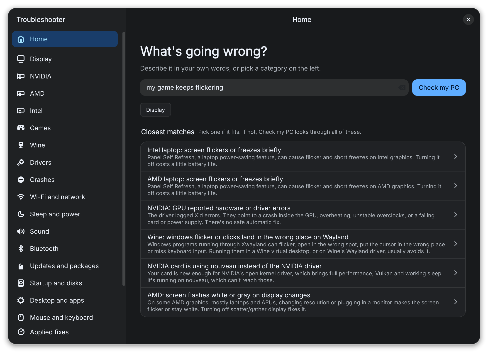

# Troubleshooter



Finds and fixes known Linux problems automagically.

Describe the problem or pick a category. It reads your logs and hardware, tells you what it would change and how confident it is, and backs up files so you can undo. Some problems are checked on launch.

Supports Arch and Arch-based distros. Each database entry states which systems it is for.

## Install

```sh
cd packaging && makepkg -si
```

This installs the app and `troubleshooter-cli`, the same thing in the terminal for when there's no desktop. `troubleshooter` also starts it when the window can't open.

## Run from source

Needs Python 3.11+, PySide6 and polkit.

```sh
python -m troubleshooter
python -m troubleshooter.interactive
python -m troubleshooter scan
python -m troubleshooter search "my game keeps flickering"
python -m troubleshooter plan nvidia-sleep
python -m unittest discover -s tests -t .
```

## Database

One TOML file per problem in `troubleshooter/data/entries/`. Invalid entries fail the tests.

```toml
id = "nvidia-drm-modeset"
title = "NVIDIA: kernel mode setting is off"
summary = "One or two plain sentences."
categories = ["nvidia", "display"]
systems = ["arch-and-based"]
keywords = ["modeset"]                     # search
symptoms = ["black screen at login"]       # search
auto_detect = true                         # check on launch, recommend at 50% or more
reproduce = "What to do to trigger it."    # optional
source = "https://wiki.archlinux.org/title/NVIDIA#DRM_kernel_mode_setting"  # optional, shown as "Read more"

[[when]]                                   # all must match, or the entry doesn't apply
source = "module"
names = ["nvidia_drm"]

[[fixed_when]]                             # any match means nothing to fix
source = "file"
path = "/sys/module/nvidia_drm/parameters/modeset"
regex = '^Y'

[[signals]]                                # evidence, combined into the confidence
says = "nvidia_drm is running with modeset off"
weight = 0.9
source = "file"
path = "/sys/module/nvidia_drm/parameters/modeset"
regex = '^N'

[[fix]]                                    # or `advice = "..."` if there's no safe fix
systems = ["arch-and-based"]               # optional, one [[fix]] per variant
reboot = true
steps = [
  { op = "kernel_params", add = ["nvidia_drm.modeset=1"] },
  { op = "initramfs" },
]
```

**systems:** `any`, `arch-only`, `arch-and-based`, `debian-only`, `debian-and-based`, `fedora-only`, `fedora-and-based`

**sources:** `pci`, `usb`, `journal`, `file`, `command`, `service`, `kernel_param`, `kernel_headers`, `package`, `module`, `cmdline`, `env`, `boot_loader`, plus `all_of` and `any_of` groups. Match with `regex`, `contains` or `absent = true`.

**ops:** `install`, `remove`, `install_aur`, `kernel_params`, `initramfs`, `write_file`, `replace`, `module_options`, `blacklist`, `sysctl`, `service`, `command`, `run_from_repo`

`run_from_repo` clones a GitHub repository at a pinned full commit hash into `/var/lib/troubleshooter/repos/` and runs a script from it with `args`; undo runs it again with `undo_args`. The MacBook Pro 2016-2017 entries (`mbp-*`) use it to run [mbp132-setup](https://github.com/360900/mbp132-setup)'s `mbp132-setup-cli.sh` for one part at a time.

Search synonyms are in `troubleshooter/data/lexicon.toml`.

Many entries are based on the [ArchWiki](https://wiki.archlinux.org/) (GFDL 1.3), written in our own words. Their `source` links to the page they come from.

## License

GPL-3.0-or-later. Inter and Geist Mono (OFL), Adwaita icons (CC-BY-SA / LGPL).
